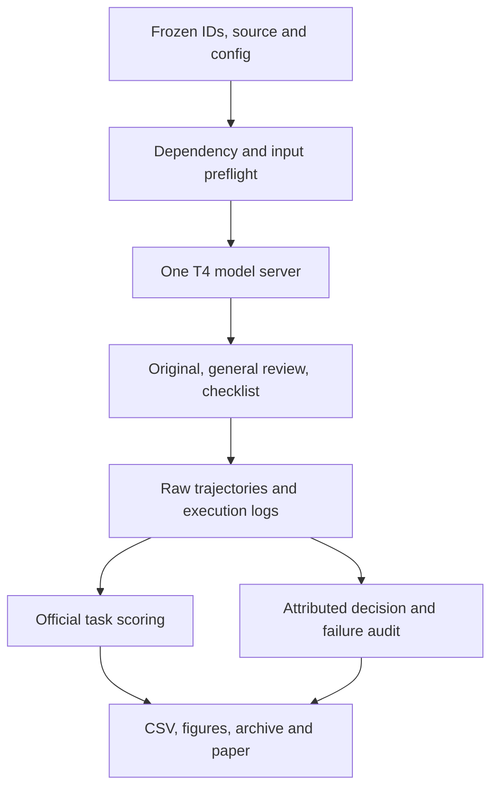

# P07: prospective evaluation blueprint (ATR-P07-v1)

Prepared on 29 October 2026 after the development pilot and before any model outputs for the selected evaluation cases. The Git commit containing this protocol is the freeze record. Existing families 1–3 are development evidence, never relabeled as unseen results. The user authorized completion of the output-based course study; publication novelty is not required.

## Question and decision rule

On the six selected BFCL tasks, what differences appear in full-task success between the unchanged original prompt, a general-review instruction, and a schema-evidence checklist? Primary comparison: schema evidence versus general review, which share the same later-tool explanation. Report the signed difference in successful-task proportions alongside raw counts. Zero or negative differences are valid results. A positive numerical difference is an observation on this sample, not statistical proof or a causal population claim.

## Dataset and split

Use Gorilla commit `6ea57973c7a6097fd7c5915698c54c17c5b1b6c8`. Development: families 1–3. Prospective evaluation: **families 89 and 73**, each with base, missing-function, and missing-parameter variants. These happen to be vehicle-control tasks; this domain limitation is disclosed. No new model outputs for these IDs were inspected during selection.

Selection is outcome-independent: take families eligible for the published certified mutator-pair definition for both missing categories; exclude development families and the ten previously identified unequal-initial-state families; sort by SHA256 of `ATR-P07-v1:<family>` and select the first two. There are 66 candidates. The config preserves selected input/reference hashes; both selected families have equal raw initial configurations across variants. Dynamic histories can diverge, so equal initial configurations do not establish a causal paired intervention design.

The six selected author-reference trajectories were checked locally with the official execution checker before freezing. All passed with zero reference execution exceptions. This is input/evaluator preflight, not model performance, and is labeled separately in `new_reference_preflight.json`.

## Inputs, outputs and modules

Inputs: official user turns, tool documents exposed by the original handler, and execution returns. References and future messages are never inserted into model prompts. No training, learned calibration, or data augmentation. Retain official preprocessing, decoding, conversation mechanics and scoring. Outputs: raw per-step generations, input logs, token counts, status, official per-case scores and archived provenance.

## Controls and settings

Keep identical model, selected task IDs, source, full answer budget and serving settings across conditions. Reuse the original three prompt texts exactly; record them in the runner. Each condition has a separate new output directory. Do not seed this run with old task results. Fixed condition order: vanilla, general review, checklist. Unequal instruction length and fixed order remain confounds; the study is descriptive and does not claim an isolated effect of schema content or matched latency.

Checkpoint `Qwen/Qwen3-4B-Instruct-2507`, revision `cdbee75f17c01a7cc42f958dc650907174af0554`; official FC registry handler. Pin both server and handler tokenizer/config revision. Verified core versions: Python 3.12, vLLM 0.8.5, torch 2.6.0, transformers 4.51.3, numpy 1.26.4, tokenizers 0.21.4, huggingface_hub 0.36.2, qwen-agent 0.0.34, soundfile 0.14.0. Preserve the original full dependency freeze and record a new one.

T4 FP16, one GPU, memory fraction 0.85, context 24576, one sequence, one BFCL thread, eager V0 engine, 2048-token chunked prefill, no CPU swap or offload, server seed 0, official generation default temperature 0.001. The guard rejects input+4096+2 above the cap. No silent truncation, answer-budget reduction or automatic replacement cases. A seed documents configuration; shared server RNG and GPU kernels do not promise bitwise reruns.

Budget: 18 total model/task records, one attempt per task/condition. Startup limit 30 minutes; generation timeout 60 minutes per condition. These are stop bounds, not a runtime estimate. Use the existing environment and cache. Cold setup requires at least 25 GiB free disk and replays observed package pins; this exact cold replay is not independently tested locally. Do not launch a second server while one occupies the GPU. Model-weight availability and cold-download time remain external dependencies.

## Metrics and missingness

Primary: official complete-task successes/6, higher is better, by condition and category. Secondary: published definition-C act-on-complete, hold-on-incomplete, decision mean and both-twins rate for eligible manifest pairs; strict no-call compliance, with unavailable decoding explicit; first failure categories; input-token summaries and logged profiler allocations. Never equate these metrics or score useful clarification prose without a separate method.

The primary denominator remains the six predefined tasks per condition. Report inference/serving exceptions separately from model task failures; an incomplete run is not a completed accuracy experiment. Force termination is retained as a task failure under the official harness. Do not infer that missing trajectories are correct abstentions. The two families are correlated groups; no p-values, narrow independent-record confidence intervals or generalization claims. Secondary metrics are prespecified here but their published eligibility and parser limitations must be checked on actual outputs.

## Required deep analysis and outputs

Perform first-failure analysis with representative genuine trace excerpts, identify state-changing attempts versus read-only exploration under the attributed definition, and reconcile task success with decision metrics. Main table: condition/category successes and totals. Secondary table: eligible pair counts and act/hold results. Figures: count bars for task outcomes and separate decision-metric bars with denominators; do not put the two measures on one unlabeled accuracy axis. Include configuration and failure/missingness tables.

## Freeze checklist and amendments

- [x] Question, primary comparison and metric recorded before new model outputs.
- [x] Development and evaluation families separated; fixed selection rule and input/reference hashes saved.
- [x] Exact policies, core environment, model/source revisions, seed, budget and failure rules recorded.
- [x] All six selected author references pass a CPU-only execution control.
- [x] Existing results retained as development; no retrospective preregistration claim.
- [ ] Colab environment/import/CLI and initial context checks pass in the actual new run.
- [ ] New outputs and score integrity checks pass; upload the genuine archive for offline analysis.

After freezing, changes require a dated decision, reason, affected files/IDs, and explicit separation of results before/after the change. Never silently rerun favorable cases, exclude failures, tune on these outputs and then call them unseen, or alter gold actions. If resource failure prevents completion, preserve the incomplete archive, state the deviation, and keep the pilot-only paper honest.
